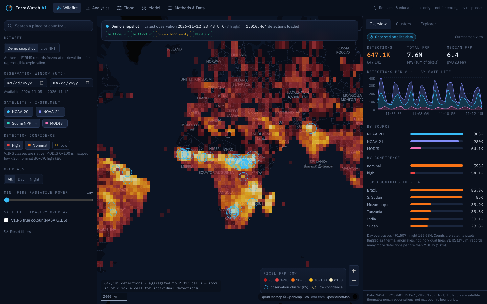
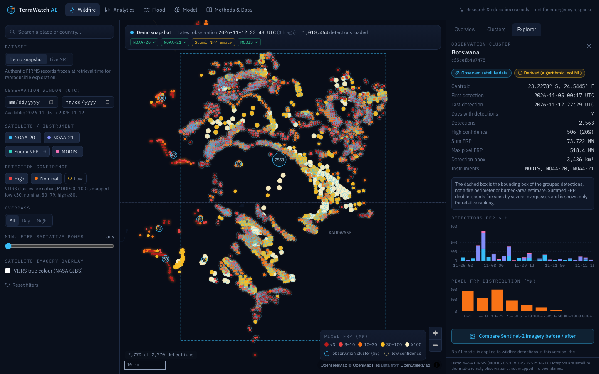
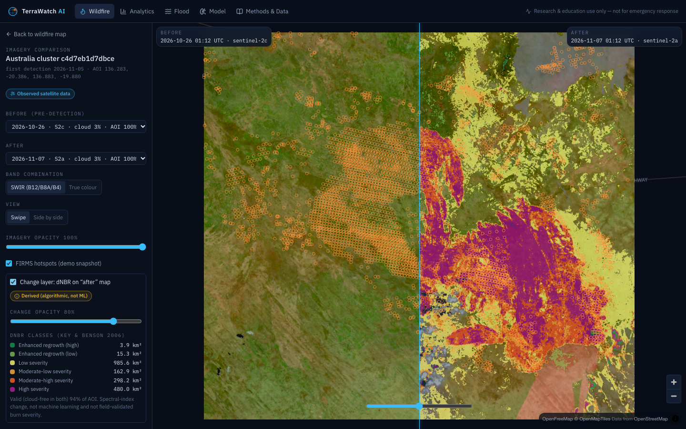
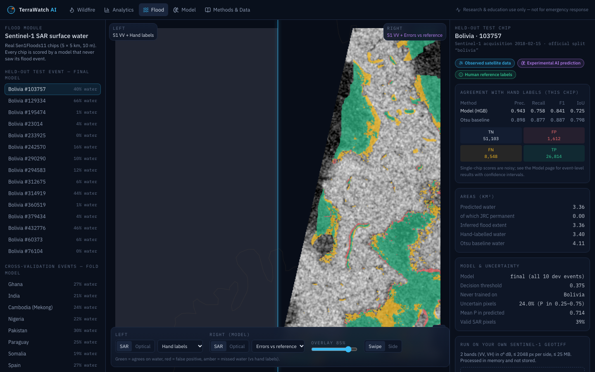
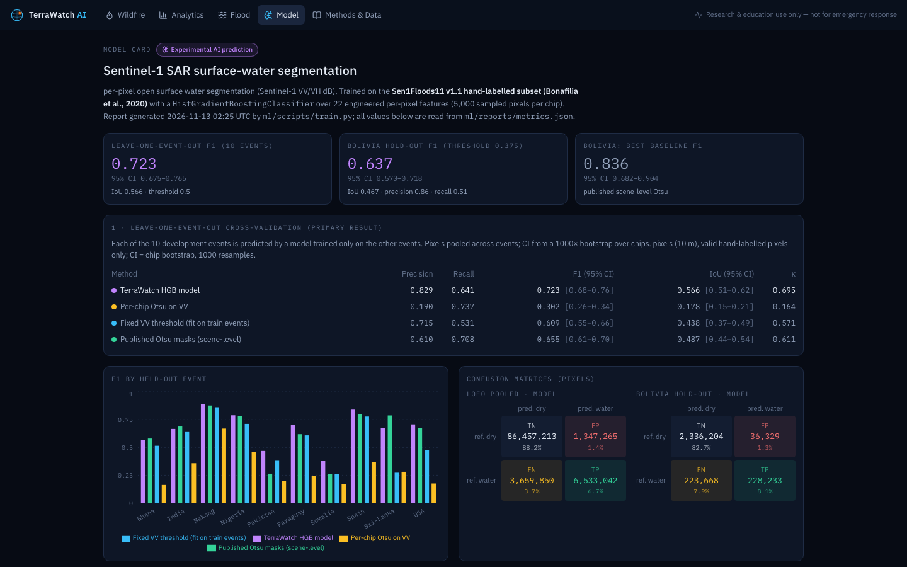
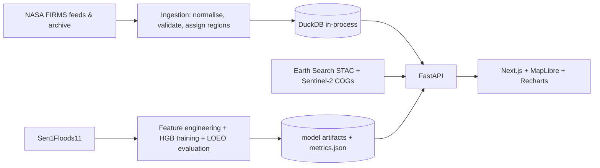

# TerraWatch AI — Satellite Disaster Intelligence Platform

**Explore real Earth-observation data for wildfires and floods. Every output is labelled as observed data, an algorithmic product, or an experimental ML prediction.**



TerraWatch AI is a full-stack geospatial application:

* **Wildfire intelligence:** ~1 million NASA FIRMS satellite fire detections from one week on an interactive global map,
  with filtering, observation clustering, per-detection inspection, regional and temporal analytics, a 2012–2025
  historical baseline, and before/after Sentinel-2 imagery with a burn-severity (dNBR) change layer.
* **Flood intelligence:** a machine-learning model that maps open water in Sentinel-1 radar imagery. It is trained and
  evaluated on the hand-labelled Sen1Floods11 dataset with leakage-controlled splits, compared against three baselines,
  and shown next to the human reference labels, JRC permanent water, and per-pixel uncertainty.

> ⚠️ **Research and education only.** Not an emergency-warning system. Hotspots are satellite thermal-anomaly
> observations, not fire perimeters; flood layers are model inferences, not verified flood maps.

---

## Why this project

Public Earth-observation data is abundant but hard to interpret correctly. A FIRMS hotspot is easy to misread as "a fire",
and a radar water mask as "the flood". This project explores how to build a tool that is technically capable (fast
geospatial queries, cloud-native imagery, real ML) and honest about uncertainty: it shows provenance, separates
observations from inferences, and publishes model results including where the model loses to a simple baseline.

## Features and verification status

| Feature | Status | How it was verified |
|---|---|---|
| Global FIRMS map (MODIS + VIIRS NOAA-20/21 + S-NPP), zoom-adaptive grid ↔ points | ✅ | API integration tests, Playwright, manual |
| Filters: date window (UTC), satellite, confidence, day/night, min FRP; geographic search | ✅ | API + unit + E2E tests |
| Live NRT mode (public FIRMS feeds, no key) with per-feed status and demo fallback | ✅ | Live refresh run 2026-11-13 (1,010,464 rows; S-NPP feed empty, flagged) |
| Observation clusters + explorer (timeline, FRP histogram, original attributes) | ✅ | Integration + E2E |
| Detection inspector (all original FIRMS attributes, 5 km/±48 h context) | ✅ | Integration tests |
| Analytics: time series by source, continent/country, day/night, MODIS 2012–2025 baselines | ✅ | Integration + E2E |
| Sentinel-2 before/after (swipe & side-by-side, multi-tile mosaics, SCL cloud mask, opacity, dNBR + legend + areas) | ✅ | Live network tests + E2E with `E2E_NETWORK=1` |
| NASA GIBS daily VIIRS true-colour overlay | ✅ | Live network test |
| SAR water model: training, LOEO + hold-out evaluation, baselines, calibration | ✅ | `ml/scripts/train.py` run end-to-end, ML unit tests |
| Flood module: held-out predictions, errors vs labels, uncertainty, inferred flood, GeoTIFF upload | ✅ | Integration + E2E |
| FIRMS Area API (custom date ranges with MAP_KEY) | ⚠️ partial | URL builder + key validation tested; not called live (no key available) |
| Docker / docker-compose / GitHub Actions | ⚠️ written, not run | Docker was not available in the build environment |

## Screenshots

| Cluster explorer | Sentinel-2 comparison + dNBR |
|---|---|
|  |  |
| **Flood module (errors vs hand labels)** | **Model card** |
|  |  |

All screenshots are of the running app on real data. Regenerate them with
`cd frontend && SCREENSHOTS=1 npx playwright test e2e/screenshots.spec.ts`.

## How it works



* **Backend** (`backend/`): FastAPI + Pydantic validation, DuckDB analytics over pandas/parquet, Shapely region assignment,
  Rasterio windowed COG reads, httpx clients with timeouts, structured error responses.
* **ML** (`ml/`): `terrawatch_ml` package (features, splits, metrics, model wrapper) shared by training and serving.
* **Frontend** (`frontend/`): Next.js 16, React 19, TypeScript, Tailwind 4, MapLibre GL 6, Recharts 3.

See [docs/ARCHITECTURE.md](docs/ARCHITECTURE.md) for the design decisions (e.g. why DuckDB instead of PostGIS).

## Machine learning: SAR surface-water segmentation

* **Data:** Sen1Floods11 hand-labelled chips: 446 Sentinel-1 VV/VH chips from 11 flood events on 6 continents.
* **Features (22/pixel):** multi-scale local mean/std, Lee speckle filter, cross-pol ratio, scene-relative terms.
* **Model:** scikit-learn `HistGradientBoostingClassifier`; threshold chosen on out-of-fold predictions.
* **Leakage control:** leave-one-event-out cross-validation plus a fully held-out event (Bolivia). Random chip splits
  leak because neighbouring chips share an image.

| Evaluation (water class, pixel level) | Model F1 [95% CI] | Best baseline F1 | Model IoU |
|---|---|---|---|
| Leave-one-event-out, 10 events (pooled) | **0.723** [0.675–0.765] | 0.655 (published scene-level Otsu) | 0.566 |
| Bolivia hold-out (out-of-distribution) | **0.637** [0.570–0.718] | **0.836** (published scene-level Otsu) | 0.467 |
| Official random split (optimistic, shares events) | 0.782 | 0.713 | 0.642 |

**Interpretation:** the model is the best method in cross-event validation, but on the Bolivia hold-out the dataset
authors' scene-level Otsu masks clearly win. The model stays precise there (0.86) but misses flooded areas (recall 0.51).
It is weakest in arid scenes (Somalia, Pakistan), where dry sand looks like water to radar. The full report, with
confusion matrices, calibration, per-event results and failure modes, is in
[docs/MODEL_EVALUATION.md](docs/MODEL_EVALUATION.md). It is generated from `ml/reports/metrics.json`.

## Quick start

Requirements: Python ≥ 3.11, Node ≥ 20 (tested with Python 3.13.5, Node 22.18), ~2 GB RAM free, internet for basemap tiles.

```bash
git clone https://github.com/apollograndiose/terrawatch-ai.git && cd terrawatch-ai
python3 -m venv .venv && source .venv/bin/activate
pip install -r backend/requirements.lock -e ./ml -e "./backend[dev]"
python ml/scripts/fetch_flood_demo.py          # 25 Sen1Floods11 demo chips (~45 MB download)
npm --prefix frontend ci
```

Run (two terminals):

```bash
cd backend && uvicorn app.main:app --port 8000
```

```bash
npm --prefix frontend run dev                  # open http://localhost:3000
```

No API keys are needed. The app starts in **demo mode** on the bundled real FIRMS snapshot. Switch to **Live NRT** in the
UI to download the current public feeds. Optional configuration lives in [.env.example](.env.example); a free FIRMS
MAP_KEY can be requested at <https://firms.modaps.eosdis.nasa.gov/api/map_key/>.

## Reproduce the results

```bash
python ml/scripts/download_sen1floods11.py --out ml/data/sen1floods11   # ~720 MB
python ml/scripts/train.py --data ml/data/sen1floods11                 # ~15 min, 8 CPU cores
python ml/scripts/render_report.py                                     # docs/MODEL_EVALUATION.md + figures
cd backend && python -m app.ingest.snapshot --window 7d                # fresh FIRMS snapshot
cd backend && python -m app.ingest.archive --countries Australia --years 2012-2025
```

Training is deterministic (`random_state=0`, seeded sampling). The same commands are wrapped in the `Makefile`.

## Tests

```bash
cd backend && pytest -m "not network"     # 36 tests: parsing, clustering, regions, validation, API, flood inference
cd backend && pytest -m network           # 5 live checks: FIRMS feeds + archive, Earth Search COG render, GIBS
cd ml && pytest tests                     # 10 tests: features, Otsu, Lee filter, metrics, fold leakage
cd frontend && npm run lint && npm run typecheck && npm test   # ESLint, tsc, 18 Vitest tests
cd frontend && E2E_NETWORK=1 npx playwright test               # 10 end-to-end workflows
```

Last local run (2026-11-13): **all 79 tests passed** (36 + 5 + 10 + 18 + 10). The integration tests use a 2,997-row sample
of the real snapshot, the real boundaries, the real flood chips and the trained model; no synthetic detections are used.

## Documentation

* [Methodology](docs/METHODOLOGY.md): what each layer means and how it is computed
* [Model evaluation](docs/MODEL_EVALUATION.md): full metrics, confusion matrices, calibration, failure modes
* [Data sources & licences](docs/DATA_SOURCES.md): endpoints, verification status, citations
* [Architecture](docs/ARCHITECTURE.md) · [Deployment](docs/DEPLOYMENT.md) · [Limitations & roadmap](docs/ROADMAP.md)

## Licence and attribution

Code: MIT ([LICENSE](LICENSE)). Data remain under their providers' terms ([docs/DATA_SOURCES.md](docs/DATA_SOURCES.md)).
FIRMS data courtesy of NASA LANCE/ESDIS. Contains modified Copernicus Sentinel data (2026). Sen1Floods11 by Bonafilia
et al. (2020); its rasters are fetched from the authors' bucket, not redistributed. Basemap © OpenMapTiles ©
OpenStreetMap contributors. Boundaries: Natural Earth.
