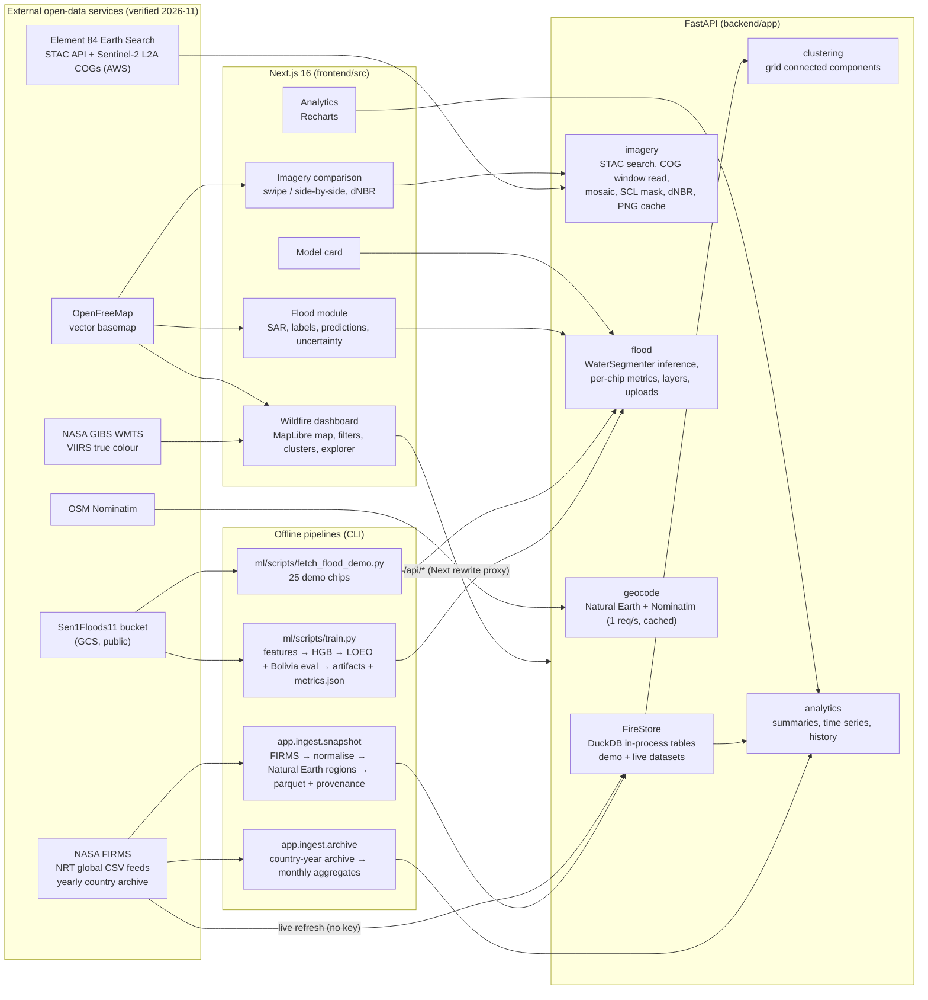

# Architecture

TerraWatch AI is a three-part monorepo: a **Next.js** frontend, a **FastAPI** backend, and a **Python ML package**
(`terrawatch_ml`) that the backend imports for inference. There is no separate database server or microservice; everything
runs on a laptop.



## Key decisions

| Decision | Why |
|---|---|
| **DuckDB in-process instead of PostGIS** | One week of global detections is ~1 M rows. DuckDB filters/aggregates it in milliseconds inside the API process, with no server to install. All spatial predicates are bounding boxes and grid binning, which need no spatial index. PostGIS becomes worthwhile for multi-year archives or polygon queries (see roadmap). |
| **Server-side zoom-dependent aggregation** | At low zoom the API returns grid cells (~5 px per cell); points are returned only when ≤ 20 k fall in view (or zoom ≥ 8, strongest-FRP first with a truncation flag). This keeps payloads small and the map at 60 fps. |
| **Columnar JSON for points** | Arrays of lon/lat/frp/... are ~3× smaller than GeoJSON on the wire; the client expands them. |
| **Cluster ids independent of the viewport** | Clusters are computed over the full filtered time window and only *listed* by viewport, so ids stay stable while panning. |
| **Next.js rewrite proxy** | The browser only calls same-origin `/api/*`; no CORS in production and the backend URL stays server-side. |
| **Model shared as a package** | `terrawatch_ml` contains features, metrics and the model wrapper used by both training and the API, which removes train/serve skew. |
| **Held-out models per chip** | The flood module scores each demo chip with a model that never saw that chip's event (final model for Bolivia, matching LOEO fold model otherwise), so on-screen metrics are genuine held-out results. |
| **Sentinel-2 read directly from COGs** | Windowed HTTP range reads at overview level + reprojection to WGS84 avoid downloading whole scenes (2–5 s per render, then cached). |

## Request lifecycle (wildfire map)

1. MapLibre `moveend` → debounced viewport (250 ms) → `GET /api/fires/map?bbox&zoom&filters`.
2. FastAPI validates every parameter with Pydantic (`DetectionFilter`), builds a parameterised DuckDB query, counts matches.
3. Response: `mode: "grid"` (cells) or `mode: "points"` (columnar), plus `dataset_served` / `fallback` flags so the UI can
   say when live data was unavailable.
4. The same filters drive `/api/analytics/summary`, `/api/analytics/timeseries` and `/api/fires/clusters` for the side panel.

## Directory layout

```
backend/app/        config, ingest (FIRMS, archive, regions), services, api routers, schemas
backend/tests/      unit + integration (real-data fixture) + opt-in live network tests
ml/terrawatch_ml/   features, data loading/splits, metrics, model wrapper
ml/scripts/         download, train/evaluate, export/fetch demo chips, render report
ml/artifacts/       trained final model + 10 LOEO fold models (joblib, ~0.5 MB each)
ml/reports/         metrics.json, per-chip metrics (all evaluation numbers)
data/demo/          FIRMS 7-day snapshot (parquet) + provenance + archive baselines
data/reference/     Natural Earth admin-0 boundaries
data/flood_demo/    chip index (rasters fetched by script)
frontend/src/       app routes, components (map, dashboard, compare, flood, model), lib
frontend/e2e/       Playwright workflows + screenshot generator
```
