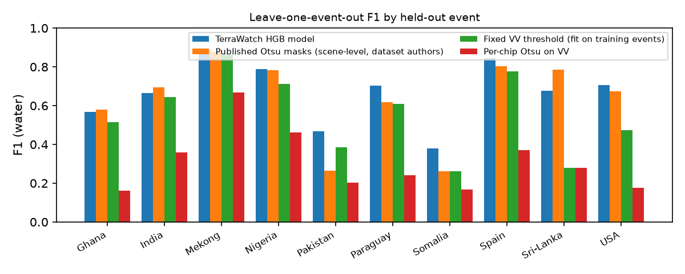
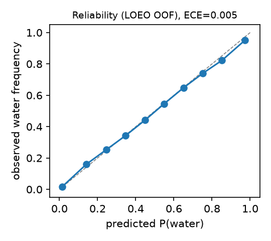
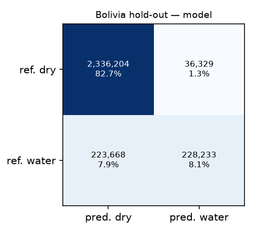

# Model evaluation

> Generated by `ml/scripts/render_report.py` from `ml/reports/metrics.json` (training run 2026-11-13T02:25:40.870218+00:00).
> Do not edit numbers by hand — re-run `python ml/scripts/train.py && python ml/scripts/render_report.py`.

## Task and data

* **Task:** per-pixel open surface water segmentation (Sentinel-1 VV/VH dB).
* **Dataset:** Sen1Floods11 v1.1 hand-labelled subset (Bonafilia et al., 2020) — 446 hand-labelled 512×512 chips (10 m) from 11 flood events
  (Bolivia, Ghana, India, Mekong/Cambodia, Nigeria, Pakistan, Paraguay, Somalia, Spain, Sri Lanka, USA), 2016–2019.
  Labels: −1 no data, 0 not water, 1 water (permanent + flood water). Sentinel-1 is GRD IW σ⁰ in dB (VV, VH)
  as pre-processed by Google Earth Engine.
* **Model:** `sklearn.ensemble.HistGradientBoostingClassifier` on 22 per-pixel features
  (`vv`, `vh`, `vv_minus_vh`, `vv_mean3`, `vh_mean3`, `vv_mean7`, `vh_mean7`, `vv_mean15`, `vh_mean15`, `vv_std3`, `vh_std3`, `vv_std7`, `vh_std7`, `vv_std15`, `vh_std15`, `vv_lee7`, `vh_lee7`, `vv_rel_median`, `vh_rel_median`, `vv_rel_otsu`, `vh_rel_otsu`, `valid_frac7`), 5,000 uniformly sampled labelled pixels per chip.
  Hyper-parameters fixed a priori: max_iter=300, learning_rate=0.1, max_leaf_nodes=31, min_samples_leaf=50, l2_regularization=1.0, early_stopping=False, random_state=0.

## Protocol (leakage control)

1. **Leave-one-event-out (LOEO)** over the 10 development events: every event is predicted by a model that never
   saw any chip from that event (chips of one event are spatially adjacent and share an acquisition date, so a random chip
   split leaks). Decision threshold 0.5.
2. **Bolivia hold-out:** Bolivia is excluded from training, feature/threshold selection and baseline fitting,
   and scored once with the final model trained on all development events.
3. **Official random split:** reported only for comparability with the literature; optimistic because it shares events.

Threshold note: Initial protocol used 0.5 for the final model. After the first Bolivia evaluation showed low recall, threshold selection on LOEO out-of-fold predictions was added. Bolivia results are reported at both thresholds (model, model_at_0.5). The final threshold (0.375) was chosen by maximising F1 on pooled
LOEO out-of-fold predictions.

Metrics are computed over all valid labelled pixels; 95% CIs come from 1,000 bootstrap resamples of chips.

## 1. Leave-one-event-out cross-validation (primary)

| Method | Precision | Recall | F1 [95% CI] | IoU [95% CI] | Cohen's κ |
|---|---:|---:|---:|---:|---:|
| **TerraWatch HGB model** | 0.829 | 0.641 | 0.723 [0.675–0.765] | 0.566 [0.510–0.619] | 0.695 |
| Published Otsu masks (scene-level, dataset authors) | 0.610 | 0.708 | 0.655 [0.607–0.701] | 0.487 [0.435–0.539] | 0.611 |
| Fixed VV threshold (fit on training events) | 0.715 | 0.531 | 0.609 [0.545–0.661] | 0.438 [0.375–0.494] | 0.571 |
| Per-chip Otsu on VV | 0.190 | 0.737 | 0.302 [0.260–0.343] | 0.178 [0.149–0.207] | 0.164 |

| Held-out event | Chips | Precision | Recall | Model F1 | Published Otsu F1 | Fixed thr. F1 | Per-chip Otsu F1 |
|---|---:|---:|---:|---:|---:|---:|---:|
| Ghana | 53 | 0.789 | 0.444 | **0.569** | 0.580 | 0.515 | 0.162 |
| India | 68 | 0.840 | 0.552 | **0.666** | 0.694 | 0.644 | 0.358 |
| Mekong | 30 | 0.914 | 0.867 | **0.890** | 0.876 | 0.861 | 0.669 |
| Nigeria | 18 | 0.962 | 0.668 | **0.788** | 0.784 | 0.712 | 0.461 |
| Pakistan | 28 | 0.413 | 0.541 | **0.468** | 0.264 | 0.385 | 0.201 |
| Paraguay | 67 | 0.903 | 0.576 | **0.704** | 0.619 | 0.609 | 0.242 |
| Somalia | 26 | 0.443 | 0.330 | **0.379** | 0.262 | 0.263 | 0.168 |
| Spain | 30 | 0.845 | 0.845 | **0.845** | 0.802 | 0.778 | 0.371 |
| Sri-Lanka | 42 | 0.955 | 0.523 | **0.676** | 0.787 | 0.278 | 0.281 |
| USA | 69 | 0.738 | 0.679 | **0.707** | 0.674 | 0.474 | 0.175 |

Calibration of out-of-fold probabilities: ECE 0.0046, Brier 0.0400.

 

## 2. Bolivia out-of-distribution hold-out

| Method | Precision | Recall | F1 [95% CI] | IoU [95% CI] | Cohen's κ |
|---|---:|---:|---:|---:|---:|
| **TerraWatch HGB model** | 0.863 | 0.505 | 0.637 [0.570–0.718] | 0.467 [0.398–0.561] | 0.588 |
| HGB model @ 0.5 (pre-registered threshold) | 0.893 | 0.379 | 0.532 [0.452–0.658] | 0.362 [0.292–0.490] | 0.483 |
| Published Otsu masks (scene-level, dataset authors) | 0.803 | 0.870 | 0.836 [0.682–0.904] | 0.718 [0.518–0.824] | 0.803 |
| Fixed VV threshold (fit on training events) | 0.880 | 0.469 | 0.612 [0.518–0.662] | 0.441 [0.350–0.495] | 0.563 |
| Per-chip Otsu on VV | 0.366 | 0.833 | 0.509 [0.264–0.687] | 0.341 [0.152–0.523] | 0.368 |

Calibration on Bolivia: ECE 0.0695, Brier 0.0753.

## 3. Official random split (optimistic)

| Method | Precision | Recall | F1 [95% CI] | IoU [95% CI] | Cohen's κ |
|---|---:|---:|---:|---:|---:|
| **TerraWatch HGB model** | 0.864 | 0.714 | 0.782 [0.659–0.856] | 0.642 [0.491–0.749] | 0.754 |
| Published Otsu masks (scene-level, dataset authors) | 0.682 | 0.748 | 0.713 [0.603–0.796] | 0.554 [0.431–0.661] | 0.671 |
| Fixed VV threshold (fit on training events) | 0.771 | 0.538 | 0.634 [0.499–0.737] | 0.464 [0.332–0.583] | 0.593 |
| Per-chip Otsu on VV | 0.227 | 0.731 | 0.346 [0.248–0.438] | 0.209 [0.142–0.280] | 0.195 |

## Permutation importance (Bolivia, ΔF1 when a feature is shuffled)

| Feature | Mean ± sd |
|---|---:|
| `vh_mean7` | 0.3574 ± 0.0046 |
| `vh_mean15` | 0.2043 ± 0.0020 |
| `vv` | 0.1250 ± 0.0020 |
| `vh_mean3` | 0.0907 ± 0.0016 |
| `vv_std15` | 0.0364 ± 0.0026 |
| `vv_mean7` | 0.0261 ± 0.0010 |
| `vh` | 0.0203 ± 0.0019 |
| `vv_std7` | 0.0156 ± 0.0013 |
| `vh_lee7` | 0.0155 ± 0.0007 |
| `vv_mean3` | 0.0154 ± 0.0006 |

## Interpretation

* In cross-event validation the model has the highest pooled F1 of all methods. The per-chip Otsu baseline is poor because
  many 5 km chips are not bimodal, a known weakness of local thresholding.
* On the Bolivia hold-out, the **published scene-level Otsu masks outperform the model** (F1 0.836 vs
  0.637). The model keeps high precision (0.863) but misses water
  (recall 0.505) and is under-confident there (ECE 0.069 vs
  0.005 in LOEO).
* The weakest LOEO events are arid scenes, where precision collapses: dry sand and smooth soil are radar-dark like water.

## Known failure modes and limitations

* Flooded vegetation and urban flooding (double-bounce → bright returns) are not captured by a darkness-based model.
* Wind-roughened water, radar shadow in steep terrain, and dry sand produce errors; no DEM/HAND or pre-event image is used.
* One acquisition per event; this is water segmentation, not pre/post change detection. "Inferred flood" in the app
  subtracts JRC permanent water and is not a verified flood map.
* Labels are human interpretations at 10 m and contain their own errors; 11 events cannot represent all climates and sensors.
* Not suitable for operational or safety-critical decisions.

## Optional advanced model (not run in this build)

A U-Net on VV/VH chips (PyTorch) is the natural next step and is commonly reported to beat thresholding on Sen1Floods11.
It was not trained here because of the laptop's disk/compute budget; no results are claimed. The same LOEO + Bolivia
protocol and `terrawatch_ml.metrics` should be reused so results are comparable.
